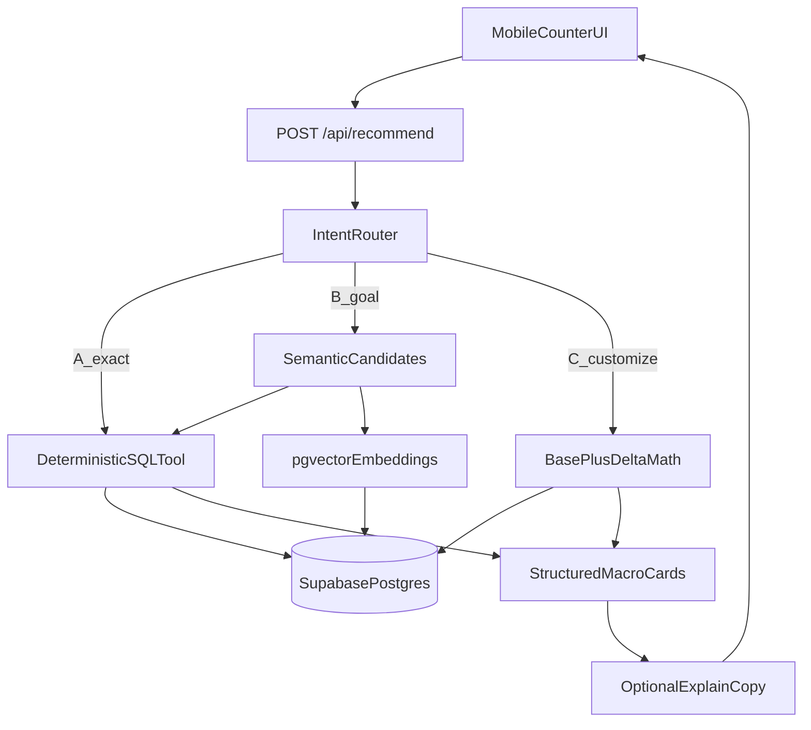

# BlendIntel v2 — Implementation Plan

**Goal:** Refactor BlendIntel into a multi-tool nutrition & recommendation system: Supabase Postgres ledger, deterministic macro math, intent router, golden eval suite, fast mobile counter UI.

**Timebox:** 6–10 hours total  
**Persona:** Buildable from Cursor mobile / floor (FDE-style); scrape = rare laptop/CI job

---

## Locked decisions

| Decision | Choice | Rationale |
|----------|--------|-----------|
| Data store | **Supabase Postgres + pgvector** | Corporate-shaped SoR; remote-only (no local Postgres) |
| Modifiers | **Curated deltas** (hand-verified top enhancers + milk/sweetener swaps) | Scrapers lack real customization nutrition; eval-safe |
| Sizes | **20 / 32 / 44 oz** (+ kids `12` if present) | Match scraped reality (not 40oz) |
| Pinecone | **Drop from v2 hot path** | Simplify ops; semantic via pgvector |
| LLM role | **Route + explain only** | Zero LLM math for calories/protein/carbs/fat/sugar |
| Agents | **Intent router + tools** (not agent swarm) | Latency + auditability |
| Floor workflow | Cloud Supabase + one init SQL + idempotent sync scripts | No desktop migration theater |

---

## Audit summary (v1 → v2)

### Keep (reuse)

| Asset | Path | Use in v2 |
|-------|------|-----------|
| Smoothie scraper | [`scrapers/smoothies.js`](../scrapers/smoothies.js) | Base menu ingest (hash sync) |
| Ingredient catalog | [`data/scrapedData/ingredients.json`](../data/scrapedData/ingredients.json) | Seed curated modifiers (macros reference) |
| Zod shapes | [`schemas/smoothieSchema.ts`](../schemas/smoothieSchema.ts) | Validate scrape → DB rows |
| Macro UI | [`NutritionGrid.tsx`](../src/app/search/components/shared/NutritionGrid.tsx), [`ResultCard.tsx`](../src/app/search/components/results/ResultCard.tsx), [`TopRecommendation.tsx`](../src/app/search/components/results/TopRecommendation.tsx) | Counter cards (+ sugar) |
| Types seed | [`menuItem.ts`](../src/app/types/menuItem.ts) | Extend for modifiers / breakdown |
| Search shell | [`SearchContext.tsx`](../src/contexts/SearchContext.tsx), layout components | Wire to new `/api/recommend` |
| OpenAI embed helper | [`libs/openai.ts`](../libs/openai.ts) | Query + document embeddings for pgvector |

### Refactor

| Asset | Change |
|-------|--------|
| [`nutritionSearchRerank/route.ts`](../src/app/api/nutritionSearchRerank/route.ts) | Replace with router + tools; GPT never receives numbers to “compute” |
| [`embed.js`](../scripts/embed.js) / upload scripts | Become Supabase sync + embed upsert |
| Upload sanitize logic | Move into typed DB writers (sizes flattened into `smoothie_sizes`) |

### Delete / deprecate (after v2 path works)

| Asset | Why |
|-------|-----|
| Pinecone client as required runtime | [`libs/pinecone.ts`](../libs/pinecone.ts), env `PINECONE_*` |
| [`/api/nutritionSearch`](../src/app/api/nutritionSearch/route.ts) | Superseded by recommend API |
| Treating baked scrape as only nutrition story | Keep scrapes as **base** rows; modifiers live in curated table |

### Explicit non-goals (timebox)

- Full Playwright scrape of live customization panels  
- Perfect milk remove/swap without SK official feed  
- Bowls / power eats parity (smoothies-first)  
- Local Docker Postgres  
- True multi-agent swarm / LangGraph  

---

## Architecture (target)



**Invariant:** Every calorie/protein/carb/fat/sugar on screen comes from SQL/TS. LLM only narrates already-computed structures.

---

## Sprint 1 — Schema & deterministic scraper + hash sync

**Budget:** ~2–2.5h

### Create

| Path | Purpose |
|------|---------|
| `supabase/migrations/001_init.sql` | Tables + indexes + `vector` extension (paste once in SQL editor = mobile-friendly) |
| `supabase/seed/modifiers_curated.json` | ~10–15 enhancers / milk / sweetener deltas by size |
| `scripts/sync-menu.ts` | Load scrape JSON → hash → upsert changed rows only |
| `scripts/embed-pgvector.ts` | Embed smoothie text → `embeddings` table |
| `libs/db.ts` | Supabase JS client (service role for sync; anon/server for API) |
| `libs/macros.ts` | Pure TS: `applyModifiers(base, deltas[])` → totals + line items |
| `.env.example` | `NEXT_PUBLIC_SUPABASE_URL`, `SUPABASE_SERVICE_ROLE_KEY`, `OPENAI_API_KEY` |

### Modify

| Path | Change |
|------|--------|
| [`package.json`](../package.json) | Add `@supabase/supabase-js`, `tsx`; scripts `sync:menu`, `embed:db` |
| [`scrapers/smoothies.js`](../scrapers/smoothies.js) | Normalize size keys (`"12"` → `small(12 oz)`); write under `data/scrapedData/` |
| [`schemas/smoothieSchema.ts`](../schemas/smoothieSchema.ts) | Align with DB size enum / hash payload |

### Schema (normalized)

```text
smoothies(id, slug, name, category, description, ingredients text[], allergens text[],
          payload_hash text, source_updated_at, created_at, updated_at)

smoothie_sizes(id, smoothie_id FK, size_key, size_oz int,
               calories, protein_g, carbs_g, fat_g, sugar_g, fiber_g, ...)

modifiers(id, slug, name, kind enum[enhancer|base_swap|sweetener|remove],
          size_key nullable,  -- null = same delta all sizes OR per-row variants
          delta_calories, delta_protein_g, delta_carbs_g, delta_fat_g, delta_sugar_g,
          replaces_slug nullable,  -- for swaps
          notes, payload_hash)

embeddings(smoothie_id PK/FK, embedding vector(512), model text, content_hash)
```

Use **cosine** ivfflat/hnsw on `embeddings.embedding` (512d to reuse current embedding practice).

### Hash sync

- `payload_hash = sha256(canonicalJSON(smoothie + sizes))`
- Upsert only when hash differs or row missing
- Log: `inserted / updated / unchanged` counts (floor-friendly)

### Edge cases

- Duplicate names / trademark symbols → stable `slug`
- Missing `sizeInformation` → skip with warning, don’t invent macros
- Identical 20oz vs 32oz scrape bug → flag in sync log (`size_anomaly`); do not “fix” with LLM
- Curated modifier must declare size or explicit “flat serving”

### Definition of Done

- [ ] `001_init.sql` applied on cloud Supabase  
- [ ] `npm run sync:menu` upserts smoothies + sizes idempotently  
- [ ] Curated modifiers seeded  
- [ ] `npm run embed:db` fills pgvector for smoothies  
- [ ] No Pinecone required for sync path  
- [ ] README snippet: env vars + “run SQL once in dashboard”

---

## Sprint 2 — Intent router & deterministic SQL/TS tools

**Budget:** ~2.5–3h

### Create

| Path | Purpose |
|------|---------|
| `src/app/api/recommend/route.ts` | Single entry: rate limit → route → tools → optional explain |
| `libs/agents/router.ts` | Fast classify → `exact` \| `goal` \| `customize` (LLM structured output **or** regex/heuristic first, LLM fallback) |
| `libs/agents/tools/sqlLookup.ts` | Exact name/size → row macros |
| `libs/agents/tools/goalFilter.ts` | SQL filters (kcal max, protein min, allergen/ingredient exclusions) |
| `libs/agents/tools/semanticSearch.ts` | Embed query → pgvector topK → ID list |
| `libs/agents/tools/customize.ts` | Load base size + apply `libs/macros.ts` deltas; return breakdown |
| `src/app/types/recommend.ts` | Request/response: intent, candidates, `macroBreakdown`, `modifierDiffs` |

### Modify

| Path | Change |
|------|--------|
| [`SearchContext.tsx`](../src/contexts/SearchContext.tsx) | Point fetch at `/api/recommend` |
| Rerank route | Deprecate or thin-proxy to recommend for compat |

### Tool contracts

**A — Exact:** parse size + name → `smoothie_sizes` only  
**B — Goal:** `semanticSearch` candidate IDs ∩ SQL `WHERE calories <= $1 AND protein_g >= $2 AND NOT ingredients @> ...`  
**C — Customize:** base macros + Σ modifier deltas; response includes `lines: [{label, delta_*}]` and `total_*`

### Edge cases

- Ambiguous size → default **32 oz** and state it in response  
- Conflicting constraints (impossible) → empty set + explicit reason (no hallucinated drink)  
- Unknown modifier slug → error tool result, don’t invent delta  
- Router misfile → tools still return structured errors; eval catches

### Definition of Done

- [ ] `/api/recommend` returns structured macros for A/B/C  
- [ ] Unit tests on `libs/macros.ts` (pure) pass  
- [ ] LLM path cannot change numeric fields (compose explain from frozen JSON)  
- [ ] Goal queries filter in SQL after semantic shortlist  
- [ ] Sub-second path for exact lookup (no rerank/GPT required)

---

## Sprint 3 — Golden dataset & automated eval suite

**Budget:** ~1.5–2h

### Create

| Path | Purpose |
|------|---------|
| `evals/golden-dataset.json` | 25 counter queries |
| `evals/recommend.eval.ts` | Vitest runner against local/staging API or in-process tools |
| `vitest.config.ts` | Node env |

### Modify

| Path | Change |
|------|--------|
| [`package.json`](../package.json) | `vitest`, script `eval` / `test` |

### Golden set mix (25)

| Bucket | Count | Assert |
|--------|-------|--------|
| Exact calorie/protein for named + size | 8 | `total_*` == DB row |
| Goal constraints | 7 | All returned rows satisfy filters |
| Modifier add / swap / remove | 7 | Totals == base + curated deltas |
| Router precision | 3 | Expected intent label |

### Edge cases in golden

- “No banana” exclusion  
- Under 400 kcal + 40g+ protein  
- Enhancer add on 32oz  
- Sweetener remove (negative delta)  
- Impossible filter → zero results OK  

### Definition of Done

- [ ] `npm run eval` runs 25 cases  
- [ ] Macro equality tests use deterministic tools only  
- [ ] Failures print expected vs actual + query id  
- [ ] Doc note: add golden case when fixing a floor bug (FDE loop)

---

## Sprint 4 — Mobile counter UI polish & Vercel deploy check

**Budget:** ~1.5–2h

### Create / modify

| Path | Purpose |
|------|---------|
| Extend [`NutritionGrid.tsx`](../src/app/search/components/shared/NutritionGrid.tsx) | Add **sugar**; optional fiber |
| New `ModifierDiff.tsx` (under `shared/` or `results/`) | Show `+/-` macro lines for customizations |
| [`SearchPageContent.tsx`](../src/app/search/SearchPageContent.tsx) / results | Emphasize cards over chat essay; keep input thumb-friendly |
| [`EmptyState.tsx`](../src/app/search/components/states/EmptyState.tsx) | Counter-style chips (exact / goal / customize examples) |
| README deploy section | Supabase env on Vercel; preview URL for floor demos |

### Edge cases

- Long AI text shouldn’t push macros below fold — macros first  
- 429 demo limit: keep or raise for pilot  
- Offline/failure: show SQL/tool error string, never fake numbers  

### Definition of Done

- [ ] Mobile viewport: query → macro card visible without hunting  
- [ ] Modifier diffs visible for intent C  
- [ ] Vercel preview builds with Supabase env  
- [ ] Smoke: 3 golden queries via production/preview URL  
- [ ] Pinecone optional/removed from required env for app runtime  

---

## Mobile / FDE workflow (cross-cutting)

| Activity | Where |
|----------|--------|
| Apply `001_init.sql` | Supabase SQL editor (once) |
| Day-to-day code | Cursor mobile against remote preview/dev |
| `sync:menu` / scrape | Laptop or CI when menu changes |
| `npm run eval` | After any router/macro change |
| Demo | Vercel preview on phone |

**Resume-ready outcomes (after ship):** deterministic macro ledger, intent-routed tools, golden eval, mobile counter UX—not “added Supabase.”

---

## Suggested hour box

| Sprint | Hours |
|--------|-------|
| 1 Schema + sync + curated seed + embed | 2.5 |
| 2 Router + tools + API | 3 |
| 3 Golden + Vitest | 2 |
| 4 UI + deploy smoke | 2 |
| **Total** | **~9.5** (cut bowls, extra agents, full scrape if over) |

---

## Out of order / defer

- Spanish / bilingual  
- Voice / Whisper  
- Redis cache  
- Official SK nutrition API replacement for scrape (pitch slide only until available)

---

## Next step after plan approval

Execute Sprint 1 first: Supabase project + `001_init.sql` + sync script + curated modifiers seed.
